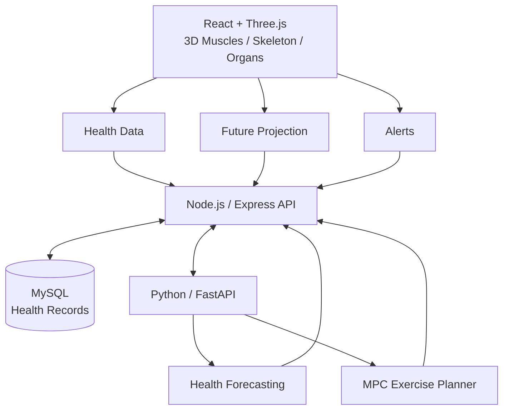

# ASTRA — Interactive Astronaut Health Monitoring

**NASA Space Apps Challenge 2026**  
**Explore the body. Understand the data. Plan for the mission.**

## The Challenge

Life in space requires astronauts to keep track of many physiological signals, from vital signs and muscle performance to bone health and organ function. Yet these measurements can be difficult to navigate when they are scattered across different charts, tables, and records. Understanding *which part of the body* a measurement belongs to, *how it is changing*, and *what to do next* should not require searching through multiple disconnected tools.

Astronauts also need to organize exercise alongside demanding mission schedules, limited training time, and accumulated fatigue. ASTRA addresses these two challenges through a unified, body-centered interface and a computational exercise planner.

## Our Solution

ASTRA is a full-stack astronaut health exploration platform built around an **interactive 3D human model using Three.js**. Users can click on anatomical regions to access relevant health indicators, visualize historical measurements, review projected trends, and explore an optimized exercise schedule.

### Three Anatomical Layers

The 3D interface presents three anatomical views: **muscular system, skeletal system, and internal organs**. Rather than presenting one enormous list of measurements, ASTRA connects each metric to the relevant region of the human body.

| Area | Example indicators |
|---|---|
| **Vital signs** | Heart rate, blood oxygen saturation, body temperature, sleep duration |
| **Muscular system** | Estimated recovery time, soreness, fatigue, strength, endurance |
| **Skeletal system** | Bone density, structure, estimated strength, bone formation, bone resorption |
| **Internal organs** | Organ-specific metrics; for example, the lungs feature oxygen-related measures, breathing rate, lung capacity, breathlessness, and breathing comfort |

Each organ can have its own set of relevant indicators. The result is an intuitive way to explore complex health information through anatomy instead of disconnected spreadsheets.

### Three Core Modules

**Health Data** — Explore the 3D body, select a region, and review its associated measurements and charts.

**Future Projection** — Examine historical health records and exploratory **7-, 14-, or 30-day projections** for supported metrics. This section also includes exercise planning and visualizations of planned activity.

**Alerts** — Surface health-related notifications and highlight values or trends that may deserve attention. Alert behavior depends on the rules and measurements available in the application.

## Scientific Computation and Exercise Planning

ASTRA separates presentation from computation. Its Python service handles statistical forecasting and constrained exercise planning, while React and Three.js focus on making the results understandable.

**Health forecasting.** The forecasting pipeline groups existing measurements by date, calculates daily medians, fits a bounded linear trend to up to 30 observation days, and generates short-horizon projections where sufficient records exist. These are exploratory estimates, not direct measurements of future health.

**Model Predictive Control (MPC).** A Python optimizer built with **SciPy / SLSQP** generates a **seven-day exercise schedule** within specified time and modeled-fatigue constraints. It distributes planned training between **resistance and aerobic exercise**, considering parameters such as available exercise time, duration targets, chosen intensities, initial fatigue, and a fatigue ceiling. Sleep can be viewed among the health indicators; it is not currently an independently verified input to the MPC decision model.

The planner optimizes a simplified scheduling model; it does not claim to predict clinical bone-health improvements caused by exercise.

## Technology Stack

| Layer | Technologies | Role |
|---|---|---|
| **Interactive anatomy** | **Three.js** | Three anatomical views, selectable body regions, 3D visualization |
| **Frontend** | **React, Vite, JavaScript, CSS** | User interface, navigation, interactive charts and controls |
| **Application backend** | **Node.js, Express.js** | REST APIs, request handling, data access, service coordination |
| **Database** | **MySQL** | User profiles and historical health measurements |
| **Authentication** | **JWT** | Authenticated access to user data |
| **Computational engine** | **Python, FastAPI, Pydantic** | Forecasting and exercise optimization over HTTP |
| **Numerical methods** | **NumPy, SciPy, SLSQP** | Statistical processing and constrained optimization |

### Architecture



The React frontend communicates with the Express API, which accesses MySQL and sends computational requests to the Python engine. The services exchange JSON, keeping scientific logic independent of the user interface.

## Data and Prototype Methodology

Individual astronaut health datasets are difficult to obtain at scale. For an early-stage prototype, ASTRA uses **application test records** to demonstrate the full pipeline, while published spaceflight research supplies scientific context for selected health indicators.

Our data workflow distinguishes:

- **Published reference results:** Values documented in traceable scientific studies, including spaceflight bone-health literature. Published cohort summaries are not presented as measurements of the current user.
- **Demo records:** Synthetic or manually supplied example inputs used to exercise the interface, forecasting pipeline, and charts. They are application test data, not new NASA observations.
- **Computed outputs:** Forecast trajectories and exercise schedules derived mathematically from the data and model assumptions.

**Monte Carlo sampling** is a possible extension for generating additional *synthetic demo records*: sample inputs from explicitly chosen distributions, enforce plausible bounds, and label the resulting records as simulated. Such sampling can help test interfaces and API behavior, but it does not create additional real astronaut observations or validate a health prediction. This workflow should only be described as implemented once the generator and its parameters are included in the repository.

Examples of research relevant to the bone-health component include [Axpe et al. (2020)](https://pmc.ncbi.nlm.nih.gov/articles/PMC6975633/) and [Gabel et al. (2022), TBone](https://pmc.ncbi.nlm.nih.gov/articles/PMC9247070/). These links identify published literature, not a claim that all application records were downloaded from a NASA database.

## Run Locally

Configure the MySQL connection and the required environment variables for each service, then start:

```bash
# Terminal 1 — Python engine (from astra-ai/)
python -m pip install -r requirements.txt
python -m uvicorn astra.api:app --reload --port 8000

# Terminal 2 — Express backend (from Backend/server/)
node app.js

# Terminal 3 — React frontend (from Frontend/client/)
npm install
npm run dev
```

| Service | URL |
|---|---|
| Frontend | `http://localhost:5173` |
| Express API | `http://localhost:3001` |
| FastAPI documentation | `http://localhost:8000/docs` |

## Built for the Hackathon

ASTRA brings together **anatomical interaction, health-data visualization, exploratory forecasting, and constrained exercise planning** in one modular full-stack prototype. Its key contribution is not another isolated chart: it is a more intuitive interface between an astronaut, the human body, and the computational tools available to support mission health decisions.
