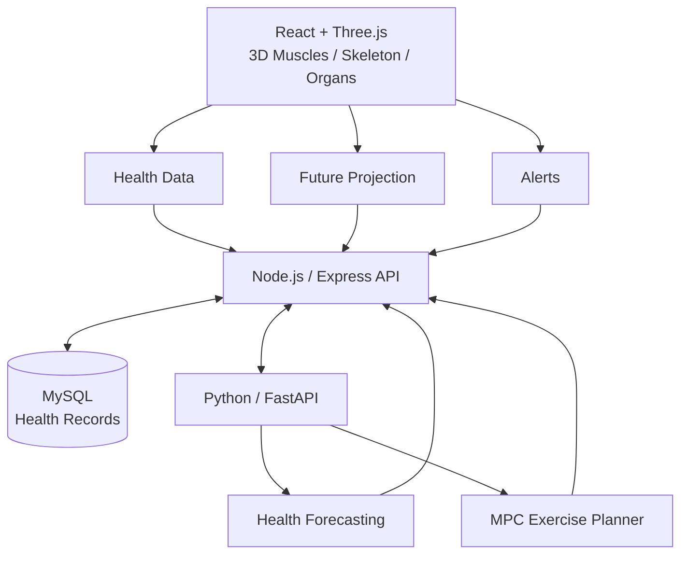

# ASTRA : Interactive Astronaut Health Monitoring

**NASA Space Apps Challenge 2026**  
**Explore the body. Understand the data. Plan for the mission.**

## The Challenge

Life in space requires astronauts to keep track of many physiological signals, from vital signs and muscle performance to bone health and organ function. Yet these measurements can be difficult to navigate when they are scattered across different charts, tables, and records. Understanding *which part of the body* a measurement belongs to, *how it is changing*, and *what to do next* should not require searching through multiple disconnected tools.

Astronauts also need to organize exercise alongside demanding mission schedules, limited training time, and accumulated fatigue. ASTRA addresses these two challenges through a unified, body-centered interface and a computational exercise planner.

## Our Solution

ASTRA is a full-stack astronaut health exploration platform built around an **interactive 3D human model using Three.js**. Users can click on anatomical regions to access relevant health indicators, visualize historical measurements, review projected trends, and explore an optimized exercise schedule.

### Three Anatomical Layers

The 3D interface presents three anatomical views: **muscular system, skeletal system, and internal organs**. Rather than presenting one enormous list of measurements, ASTRA connects each metric to the relevant region of the human body.

| Area | Example indicators |
|---|---|
| **Vital signs** | Heart rate, blood oxygen saturation, body temperature, sleep duration |
| **Muscular system** | Estimated recovery time, soreness, fatigue, strength, endurance |
| **Skeletal system** | Bone density, structure, estimated strength, bone formation, bone resorption |
| **Internal organs** | Organ-specific metrics; for example, the lungs feature oxygen-related measures, breathing rate, lung capacity, breathlessness, and breathing comfort |

Each organ can have its own set of relevant indicators. The result is an intuitive way to explore complex health information through anatomy instead of disconnected spreadsheets.

### Three Core Modules

**Health Data**  Explore the 3D body, select a region, and review its associated measurements and charts.

**Future Projection**  Examine historical health records and exploratory **7-, 14-, or 30-day projections** for supported metrics. This section also includes exercise planning and visualizations of planned activity.

**Alerts**  Surface health-related notifications and highlight values or trends that may deserve attention. Alert behavior depends on the rules and measurements available in the application.

## Scientific Computation and Exercise Planning

ASTRA separates presentation from computation. Its Python service handles statistical forecasting and constrained exercise planning, while React and Three.js focus on making the results understandable.

**Health forecasting.** The forecasting pipeline groups existing measurements by date, calculates daily medians, fits a bounded linear trend to up to 30 observation days, and generates short-horizon projections where sufficient records exist. These are exploratory estimates, not direct measurements of future health.

**Model Predictive Control (MPC).** A Python optimizer built with **SciPy / SLSQP** generates a **seven-day exercise schedule** within specified time and modeled-fatigue constraints. It distributes planned training between **resistance and aerobic exercise**, considering parameters such as available exercise time, duration targets, chosen intensities, initial fatigue, and a fatigue ceiling. Sleep can be viewed among the health indicators; it is not currently an independently verified input to the MPC decision model.

The planner optimizes a simplified scheduling model; it does not claim to predict clinical bone-health improvements caused by exercise.

## Technology Stack

| Layer | Technologies | Role |
|---|---|---|
| **3D Anatomy** | **Three.js, React** | Interactive muscular, skeletal, and organ views with selectable regions |
| **Frontend** | **React, Vite, JavaScript/JSX, CSS, React Router** | Responsive pages, health charts, controls, and client-side navigation |
| **Backend** | **Node.js, Express.js** | REST APIs, business logic, request validation, and coordination between services |
| **Database** | **MySQL** | User accounts and historical physiological measurements |
| **Authentication** | **JWT** | Token-based protected access |
| **Computational Engine** | **Python, FastAPI, Pydantic** | Health forecasting, computational endpoints, and validated inputs |
| **Optimization** | **NumPy, SciPy, SLSQP, MPC** | Numerical calculations and constrained exercise scheduling |
| **Data Prototyping** | **Monte Carlo Sampling** | Generate synthetic records for MVP workflows under explicit sampling assumptions |
| **Integration** | **HTTP, JSON, REST APIs** | Communication between React, Express, and FastAPI |
| **Development & Testing** | **Git, GitHub, Postman** | Collaboration, version control, and API verification |

### Architecture



The React frontend communicates with the Express API, which accesses MySQL and sends computational requests to the Python engine. The services exchange JSON, keeping scientific logic independent of the user interface.

## Data and Prototype Methodology

A major challenge during development was **limited access to sufficiently large, individual-level astronaut health datasets**. We worked with a small collection of reference material from NASA and publicly available scientific sources, but its coverage was not enough to train and evaluate complex, data-hungry machine-learning models reliably.

To support a functioning hackathon MVP, we used a **Monte Carlo sample generator** to produce additional **synthetic demonstration records** from our limited reference inputs and chosen sampling assumptions. This helped us populate the application, test its data flow, and demonstrate health visualizations and short-horizon forecasts despite the scarcity of observations. The generated records are **simulated examples, not additional measurements collected by NASA or astronauts**.

The application keeps three types of information distinct:

- **Research references:** Published findings used to inform the scientific context of selected health indicators.
- **Synthetic prototype records:** Monte Carlo-generated or manually supplied examples used for demonstration and software testing.
- **Computed outputs:** Statistical projections and exercise schedules produced by the forecasting and optimization modules.

Because simulated records cannot replace independent real-world observations, we chose **transparent statistical forecasting and constrained optimization** over claiming a fully trained, clinically validated physiological AI model. This lets ASTRA demonstrate the complete product experience while leaving room for future calibration with larger astronaut datasets.

Relevant published bone-health references include [Axpe et al. (2020)](https://pmc.ncbi.nlm.nih.gov/articles/PMC6975633/) and [Gabel et al. (2022), TBone](https://pmc.ncbi.nlm.nih.gov/articles/PMC9247070/). Source publications, synthetic records, and model outputs are not treated as interchangeable.


## Installation & Quick Start

ASTRA requires Node.js, Python 3, and MySQL Server.

For complete setup instructions, including MySQL configuration,
database initialization, environment variables, and demo login
credentials, follow the guide below:

**[ASTRA - Quick Start Guide](./ASTRA_QUICK_START.md)**

Once configured, start the three services in separate terminals:

### Terminal 1 — Backend

```bash
cd Backend/server
npm run dev
```

### Terminal 2 — Frontend

```bash
cd Frontend
npm run dev
```

### Terminal 3 — Python Engine

```bash
cd astra-ai
python -m uvicorn astra.api:app --reload --port 8000
```

### Local URLs

| Service | URL |
|---|---|
| ASTRA Application | http://localhost:5173 |
| Express API Health Check | http://localhost:3001/healthz |
| FastAPI Documentation | http://127.0.0.1:8000/docs |
```

## Built for the Hackathon

ASTRA brings together **anatomical interaction, health-data visualization, exploratory forecasting, and constrained exercise planning** in one modular full-stack prototype. Its key contribution is not another isolated chart: it is a more intuitive interface between an astronaut, the human body, and the computational tools available to support mission health decisions.
