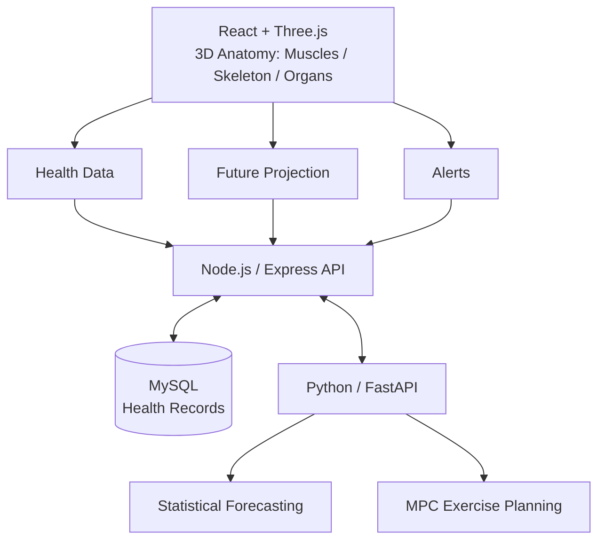

# ASTRA — Astronaut Health Monitoring

**NASA Space Apps Challenge 2026**

## The Problem

Astronaut health is monitored through many different physiological measurements, but reviewing those measurements in separate tables and charts makes it difficult to understand how they relate to the human body. During a mission, astronauts also need a clear way to explore health trends, recognize potential concerns, and organize exercise within limited time and fatigue constraints.

**ASTRA brings health visualization, future trends, alerts, and exercise planning into one accessible interface.**

## Our Solution

At the center of ASTRA is an **interactive 3D human model built with Three.js**. Instead of searching through disconnected health records, an astronaut can select a body region and immediately explore its associated measurements, trends, and explanations. The model provides three anatomical views: **muscular system, skeletal system, and internal organs**.

### Explore Health by Body Region

The interface brings together a broad range of measurements, with indicators tailored to the selected body system:

| Body system | Examples of displayed indicators |
|---|---|
| **Vital signs** | Heart rate, oxygen saturation, body temperature, sleep duration |
| **Muscular system** | Estimated recovery time, soreness, fatigue, strength, endurance |
| **Skeletal system** | Bone density, bone structure, bone strength, bone building, bone breakdown |
| **Internal organs** | Organ-specific measurements; for example, the **lungs** show blood oxygen, breathing rate, lung capacity, breathlessness, and breathing comfort |

Other organs have their own relevant indicators, enabling users to navigate health information anatomically rather than through a single overwhelming table. The interface is designed to make complex physiological data easier to find and interpret; the availability and provenance of individual readings depend on the underlying records.

### Main Modules

| Module | What it provides |
|---|---|
| **Health Data** | Interactive anatomical exploration, measurements, and visualizations for the selected body region |
| **Future Projection** | Historical trends, exploratory 7-, 14-, and 30-day forecasts where supported, and a seven-day exercise plan |
| **Alerts** | Health-related notifications that draw attention to measurements requiring review |

### Exercise Planning with MPC

ASTRA includes a Python-based **Model Predictive Control (MPC)** exercise planner. Given an exercise-time budget, daily targets, selected intensity levels, and an initial fatigue estimate, it calculates a **seven-day schedule** balancing aerobic and resistance exercise under time and modeled-fatigue constraints.

Sleep is monitored among the health indicators; the current MPC implementation is **not yet validated as using sleep to modify exercise decisions**. Likewise, the fatigue model is illustrative rather than a clinical measure, and the plan should not be interpreted as a medical prescription.

## Technology Stack

| Layer | Technology | Responsibility |
|---|---|---|
| **3D visualization** | **Three.js** | Interactive anatomical views and clickable body regions |
| **Frontend** | **React, Vite, JavaScript, CSS** | Health dashboard, charts, navigation, and exercise controls |
| **Backend** | **Node.js, Express** | REST APIs, authentication, data access, and orchestration |
| **Database** | **MySQL** | User profiles and historical physiological measurements |
| **Authentication** | **JWT** | Protected access to user-specific records |
| **Scientific engine** | **Python, FastAPI, Pydantic** | Validated inputs, forecasting, and optimization endpoints |
| **Numerical methods** | **NumPy, SciPy / SLSQP** | Statistical calculations and constrained exercise scheduling |

### System Architecture



The frontend presents information, Express manages application logic and database access, and Python performs the numerical computations. Services exchange JSON over HTTP.

## Data Sources & Scientific Transparency

Spaceflight health datasets are limited, particularly when individual-level physiological records are involved. ASTRA therefore distinguishes **three different types of data**:

| Data type | Meaning | How it should appear |
|---|---|---|
| **Source data** | Original, traceable measurements from public datasets or scientific publications | Identified with source, units, and measurement context |
| **Synthetic demo samples** | Artificial examples produced by a sample generator using stated assumptions informed by the available evidence | Explicitly labeled **synthetic**, never presented as astronaut measurements |
| **Model estimates** | Forecasts or optimized schedules computed from inputs | Identified as estimates, not observations |

Where original NASA-associated or published research records are available, they inform the scientific context. **Generating additional samples does not create new evidence, prove a distribution is representative, or validate a prediction model.** Synthetic data are suitable for demonstrating the interface and testing the end-to-end pipeline, not for claiming clinical accuracy.

The current forecasting pipeline calculates daily medians from historical records, fits a constrained linear trend using up to 30 observation days, and produces exploratory **7-, 14-, or 30-day** estimates. Insufficient data should yield an unavailable result rather than invented predictions.

> **Before submission:** Document the exact NASA dataset IDs / research citations used and the sample generator's method and parameters. Do not describe a generator or a dataset as deployed until confirmed in the repository.

## Run Locally

The application uses three development services and a MySQL database. Configure each service's environment variables and database connection first.

```bash
# Terminal 1 — from astra-ai/
python -m pip install -r requirements.txt
python -m uvicorn astra.api:app --reload --port 8000

# Terminal 2 — from Backend/server/
node app.js

# Terminal 3 — from Frontend/client/
npm install
npm run dev
```

| Service | Local address |
|---|---|
| React | `http://localhost:5173` |
| Node.js / Express | `http://localhost:3001` |
| FastAPI / Swagger | `http://localhost:8000` / `http://localhost:8000/docs` |

## Project Status

ASTRA is a **hackathon prototype**, not a clinically validated astronaut health system. Interactive monitoring, historical-trend forecasting, and constrained exercise scheduling form the core implementation. Alert rules and exercise-impact comparisons should be described according to their verified integration status in the submitted build.
