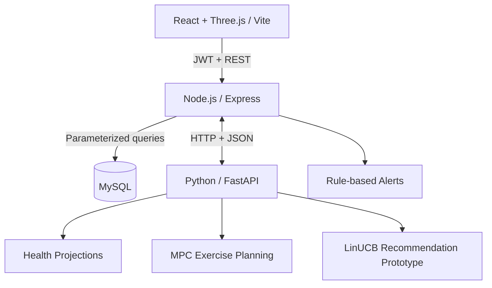

# Olympus Health Interactive Astronaut Health Monitoring

**NASA Space Apps Challenge 2026**  
**Team: Olympus Mons**  

## The Challenge

Life in space requires astronauts to keep track of many physiological signals, from vital signs and muscle performance to bone health and organ function. Yet these measurements can be difficult to navigate when they are scattered across different charts, tables, and records. Understanding *which part of the body* a measurement belongs to, *how it is changing*, and *what to do next* should not require searching through multiple disconnected tools.

Astronauts also need to organize exercise alongside demanding mission schedules, limited training time, and accumulated fatigue. Olympus Health addresses these two challenges through a unified, body-centered interface and a computational exercise planner.

## Our Solution

Olympus Health is a full-stack astronaut health exploration platform built around an **interactive 3D human model using Three.js**. Users can select anatomical regions to access related health indicators, visualize historical measurements, review exploratory projections, receive rule-based alerts, and explore exercise plans.

### Three Anatomical Layers

The 3D interface presents three anatomical views: **muscular system, skeletal system, and internal organs**. Rather than displaying one enormous list of measurements, Olympus Health relates health information to the selected anatomy.

| Area | Available / example indicators |
|---|---|
| **Vital signs** | Heart rate, blood oxygen saturation, body temperature, sleep duration |
| **Muscular system** | Muscle atrophy, type I/II muscle fibers, neuromuscular coordination; more detailed regional status when recorded |
| **Skeletal system** | Bone density, bone quality, bone formation (P1NP), bone resorption (CTX); regional status when recorded |
| **Internal organs** | Heart rhythm and oxygen-related metrics, kidney risk indicators, and other organ-specific fields when stored and connected to the API |

**User-specific anatomy data:** When a body part is selected, React calls a JWT-protected Express endpoint (`GET /api/anatomy/:system/:key`). The backend retrieves records belonging to the authenticated user. It distinguishes:

- **Part-specific measurements** from `anatomy_part_measurements`, linked to the selected anatomical structure.
- **Related context measurements** from `generic_health`, `muscle_health`, `bone_health`, or `organ_health`. Context is not claimed to be a measurement of the selected individual structure.

Missing data is shown as unavailable rather than replaced with random anatomical values. The current API supports related general readings for muscle and skeletal selections and particular mappings for the heart, lungs, and kidneys; other organs require stored part-specific readings or additional API mappings.

### Core Modules

**Interactive Anatomy** Select a muscle, bone, or organ to inspect available part-specific readings and related health data from MySQL.

**Health Data** Review recorded vital signs, historical charts, and measurements. Authenticated users can add new records through the API.

**Alerts** Highlight recorded values and trends requiring review using preliminary **High / Medium / Low** priority rules.

**Future Projection** Examine exploratory short-horizon projections and physiological trends; the available views depend on the supported model and stored records.

## Scientific Computation and Exercise Planning

Olympus Health separates presentation from computation. Its Python service provides health projection and exercise-planning endpoints, while React and Three.js present the outputs.

**Health forecasting.** The application explores health trends and model-based projections using available records and scientific assumptions. These are exploratory estimates, not direct measurements of future health or clinically validated individual predictions.

**Model Predictive Control (MPC).** A Python optimizer using **SciPy / SLSQP** explores a seven-day exercise schedule subject to time and modeled-fatigue constraints, including resistance and aerobic exercise. The planner optimizes a simplified scheduling model; it does not establish that the prescribed training causes specific clinical improvements.

**Adaptive recommendations.** The prototype also includes a **LinUCB** recommendation component. Its demo feedback loop should not be represented as trained or validated on astronaut medical outcomes.

## Technology Stack

| Layer | Technologies | Role |
|---|---|---|
| **Interactive 3D Anatomy** | Three.js, React | Muscular, skeletal, and organ views with selectable regions |
| **Frontend** | React, Vite, JavaScript (JSX), CSS, React Router | Pages, interactive health charts, forms, and navigation |
| **Application Backend** | Node.js, Express.js | Authenticated REST APIs, anatomy lookup, alerts, business logic |
| **Database** | MySQL | User accounts, health histories, anatomical catalog, and part-specific measurements |
| **Authentication & Security** | JWT, bcrypt, CORS, express-rate-limit | Password hashing, authorized access, and request controls |
| **Computational Engine** | Python, FastAPI, Pydantic | Model endpoints, validation, forecasting, and planning |
| **Numerical Computing & Optimization** | NumPy, SciPy, SLSQP, MPC | Numerical methods and constrained exercise scheduling |
| **Adaptive Decision-Making** | LinUCB | Prototype contextual exercise recommendation logic |
| **Data Prototyping** | Monte Carlo sampling | Synthetic records for MVP demonstrations under documented assumptions |
| **Integration** | HTTP, JSON, REST APIs, Fetch API | Communication among frontend, Express API, and Python service |
| **Development & Testing** | Git, GitHub, Postman | Source control, collaboration, and API verification |

### System Architecture



The React frontend does **not** connect to MySQL directly. Express verifies the user's JWT, filters data by the authenticated `user_id`, and queries the database. Scientific computations run in the separate Python service.

## Database Schema

The following diagram shows the project's MySQL tables and relationships, including the user-centered health tables, anatomy-specific measurements, and additional organ-specific structures.


*Figure: Olympus Health database schema, visualized in MySQL Workbench.*

### Main Database Tables

| Table | Purpose |
|---|---|
| `users` | User accounts with username, hashed password, gender, and age |
| `generic_health` | Heart rate, oxygen saturation, body temperature, and sleep duration |
| `muscle_health` | General muscle atrophy, muscle fiber types, and neuromuscular coordination |
| `bone_health` | Bone density, quality, formation marker P1NP, and resorption marker CTX |
| `organ_health` | Arrhythmia, kidney stone risk, and oxygen status |
| `space_radiation` | Radiation doses, dose rate, and radiation event flags |
| `anatomy_parts` | Catalog of selectable muscles, bones, and organs using `system` and `part_key` |
| `anatomy_part_measurements` | User-linked measurements for individual anatomical parts, including metric, value, unit, origin, and timestamp |

### Additional Tables Shown in the Diagram

The supplied schema diagram also contains `heart`, `lungs`, `kidneys`, `liver`, `brain`, `small_intestine`, `bone_status`, and `muscle_status`. These represent additional organ-specific and region-specific measurements.

## Data and Prototype Methodology

A major challenge during development was **limited access to sufficiently large, individual-level astronaut health datasets**. We worked with reference material from NASA and publicly available scientific sources, but available observations were not sufficient to reliably train and evaluate data-hungry machine-learning models.

For the hackathon MVP, we used **Monte Carlo sampling** and other synthetic demonstration data to populate workflows and test charts, alerts, and projections. Such records are **simulated examples, not additional measurements collected by NASA or astronauts**.

The platform distinguishes:

- **Research references:** Published material informing scientific context and modeling assumptions.
- **Synthetic prototype records:** Simulated or manually supplied examples for demos and testing.
- **Stored user records:** Measurements submitted to or already present in the authenticated user's database records; their origin should be recorded where available.
- **Computed outputs:** Projections and exercise schedules produced by the computational models.

Synthetic records cannot replace independent real observations, and Olympus Health does not claim a clinically validated physiological AI model.

Relevant bone-health literature includes [Axpe et al. (2020)](https://pmc.ncbi.nlm.nih.gov/articles/PMC6975633/) and [Gabel et al. (2022)](https://pmc.ncbi.nlm.nih.gov/articles/PMC9247070/). Publications, synthetic records, and model outputs must not be treated as interchangeable.

## Installation & Quick Start

**Prerequisites:** Node.js, Python 3, and MySQL Server.

For step-by-step installation, MySQL setup, `.env` configuration, demo account credentials, and initial setup commands, use:


**[Olympus Health — Quick Start Guide](https://github.com/pr0mak/SpaceAppChallenge/blob/main/Olympus Health_SETUP_INSTRUCTIONS.md)**


Once configured, launch the three services in separate terminals from the repository root:

**Terminal 1 Backend**

```bash
cd Backend/server
npm run dev
```

**Terminal 2 Frontend**

```bash
cd Frontend
npm run dev
```

**Terminal 3 Python Engine**

```bash
cd Olympus Health-ai
python -m uvicorn Olympus Health.api:app --reload --port 8000
```


## Team Olympus Mons

Olympus Health was developed by **Olympus Mons** for the **NASA Space Apps Challenge 2026**.

> [Michail Marakis](https://github.com/Michail-Marakis), BSc Student  
> Department of Informatics, Athens University of Economics and Business

> [Periklis Papakostas](https://github.com/CodePeriklis), BSc Student  
> Department of Informatics, Athens University of Economics and Business

> [Prodromos-Aris Makarounas](https://github.com/pr0mak), BSc Student  
> Department of Informatics, Athens University of Economics and Business

> [Stavros Rodopoulos](https://github.com/ShadowtheCross), BSc Student  
> Department of Informatics, Athens University of Economics and Business

> [Nikolaos Poulopoulos](https://github.com/nikwilldoit), BSc Student  
> Department of Informatics, Athens University of Economics and Business


## Built for the Hackathon

Olympus Health combines **anatomical interaction, user-specific health visualization, rule-based alerts, exploratory forecasting, and constrained exercise planning** in one modular full-stack prototype. Its goal is to make astronaut health information more accessible through the human body while clearly separating stored data, synthetic examples, and model-derived outputs.
